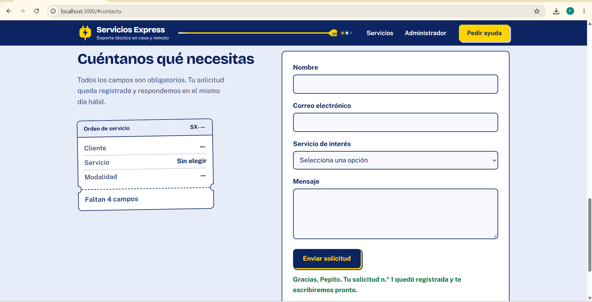
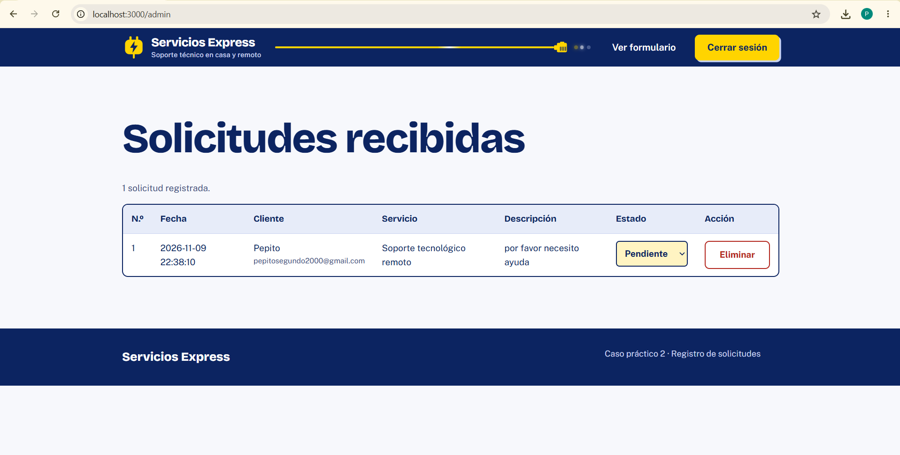
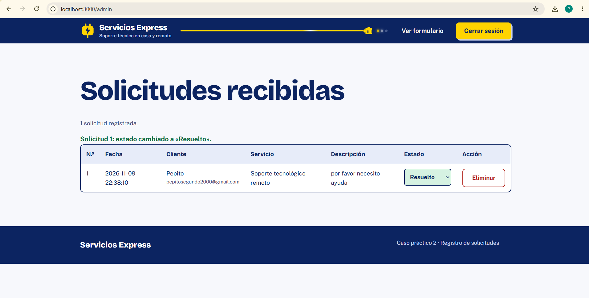
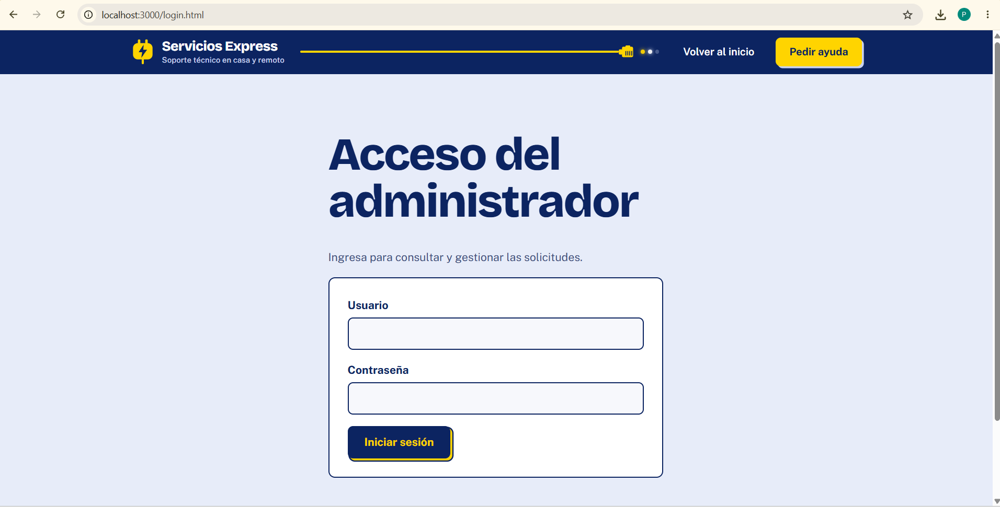
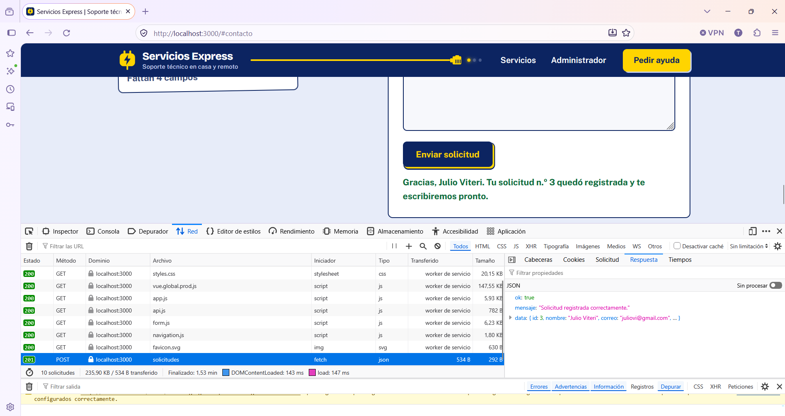
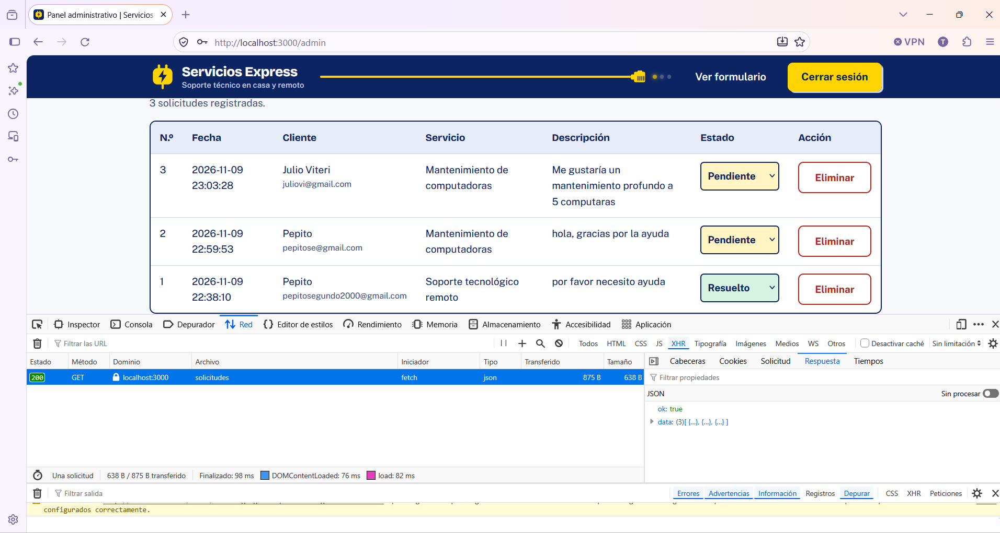
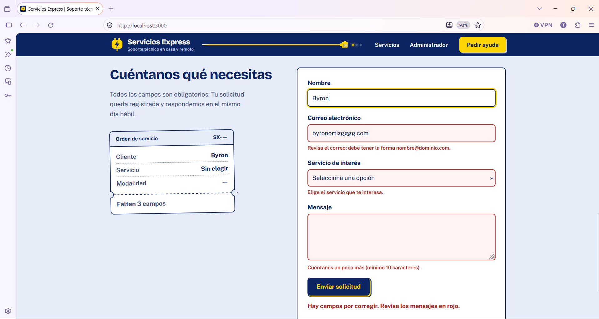
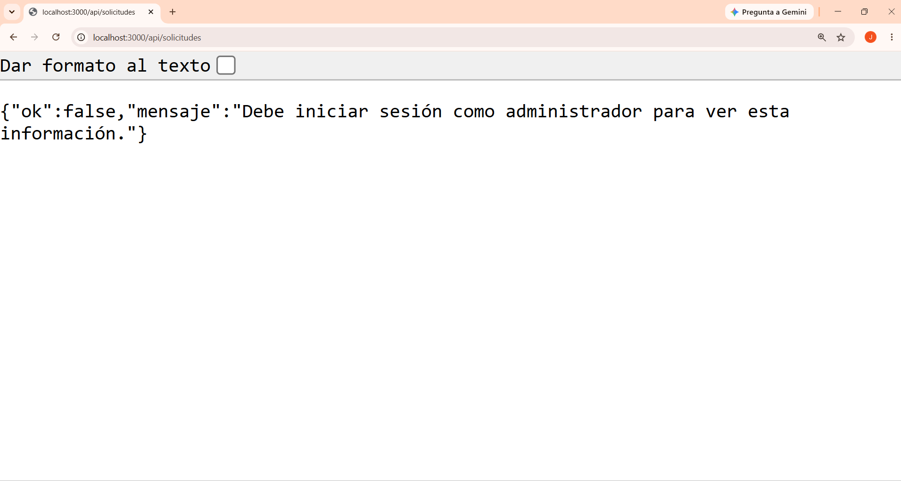
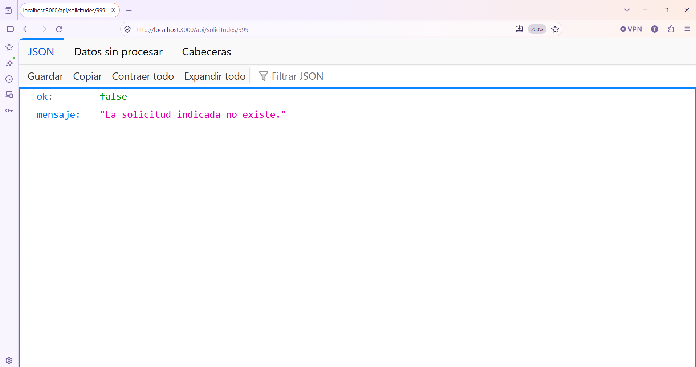

# Del formulario a la base de datos – Servicios Express

Caso práctico 2 · Unidad 2: Desarrollo del lado del servidor e integración
Estudiante: Julio Israel Viteri Romero · Tecnologías: Node.js 22+, Express, SQLite (módulo integrado `node:sqlite`), HTML/CSS/JavaScript y Vue 3 (front-end del caso 1)

Este proyecto continúa el prototipo de **Servicios Express** del caso 1: se conserva su diseño, sus tres servicios, el componente Vue `TarjetaServicio` y la validación del formulario, y ahora el formulario **guarda las solicitudes en una base de datos** a través de un servidor.

## Cómo ejecutar

Requisito: **Node.js 22.13 o superior** (`node -v`). SQLite viene incluido en Node, solo se instalan Express y express-session.

```bash
npm install
npm start          # http://localhost:3000
```

- Página y formulario del cliente: `http://localhost:3000/`
- Panel administrativo: `http://localhost:3000/admin` (pide iniciar sesión)
- Credenciales **de prueba**: usuario `admin` · contraseña `admin123` (se pueden cambiar con las variables `ADMIN_USER` y `ADMIN_PASS`).
- La base de datos `database/solicitudes.db` se crea sola al iniciar, a partir de `database/schema.sql`.
- Si Node muestra un aviso «SQLite is an experimental feature», es normal y no afecta el funcionamiento.

**Nota de seguridad:** Las credenciales del administrador son únicamente para fines académicos y pruebas locales. En un entorno real, deben reemplazarse por credenciales seguras.

## 1. Arquitectura

```
┌────────────────┐   petición HTTP (JSON)   ┌─────────────────────┐   SQL    ┌────────────────┐
│  NAVEGADOR     │ ───────────────────────► │  SERVIDOR (Express) │ ───────► │  BASE DE DATOS │
│  (front-end)   │                          │  rutas → controlador│          │  SQLite        │
│  HTML/CSS/JS   │ ◄─────────────────────── │  → modelo           │ ◄─────── │  solicitudes   │
└────────────────┘   respuesta JSON         └─────────────────────┘ filas    └────────────────┘
```

**Responsabilidades (66 palabras):** El front-end (navegador) muestra el formulario y el panel, valida lo básico y envía peticiones HTTP. El back-end (Express) recibe las peticiones, valida los datos, controla la sesión del administrador y decide qué operación ejecutar. La base de datos (SQLite) guarda las solicitudes de forma permanente y las devuelve cuando el servidor las pide. El servidor es el único que accede a la base de datos.

### Organización de carpetas

```
├── server.js                  # arranque, middlewares y rutas principales
├── config/config.js           # puerto, credenciales de prueba, servicios y estados
├── routes/                    # URL → controlador (solicitudRoutes.js, authRoutes.js)
├── controllers/               # lógica: validar y responder (solicitudController.js, authController.js)
├── models/solicitudModel.js   # acceso a datos (único lugar con SQL)
├── middleware/auth.js         # protección de la API y de la página /admin
├── database/                  # schema.sql (estructura) y db.js (conexión a SQLite)
├── public/                    # front-end y recursos estáticos (visibles para cualquiera)
│   ├── index.html             #   página y formulario (caso 1 + envío al servidor)
│   ├── login.html             #   inicio de sesión del administrador
│   ├── css/                   #   styles.css (caso 1) y admin.css (login y panel)
│   ├── js/                    #   app.js (Vue), form.js, navigation.js, api.js, login.js, admin.js, vendor/vue
│   └── fonts/, favicon.svg    #   tipografías y favicon del caso 1
├── views/admin.html           # panel privado (fuera de /public: solo se entrega con sesión)
└── evidencias/                # capturas de pantalla
```

### Integración con el caso 1

| Qué                                | Cambio                                                                                           |
|------------------------------------|--------------------------------------------------------------------------------------------------|
| `js/form.js`                       | Conserva la validación; ahora, si todo es correcto, envía la solicitud con `POST /api/solicitudes` y muestra la respuesta del servidor |
| `js/api.js` (nuevo)                | Función `pedir()` que centraliza las llamadas `fetch`                                            |
| `index.html`                       | Se quitó la sección «Información externa» y `external.js` (ya no hacían falta); el menú enlaza al panel del administrador |
| `login.html`, `views/admin.html`   | Páginas nuevas con la cabecera y los estilos del caso 1                                          |
| Servicios                          | Los tres del caso 1 son los valores permitidos del campo `servicio`                              |


## 2. Modelo de datos: recurso `Solicitud`

| Campo       | Tipo (SQLite)           | Obligatorio | Validación básica                                          |
|-------------|-------------------------|-------------|------------------------------------------------------------|
| id          | INTEGER (autoincrement) | Sí (auto)   | Generado por la base de datos                              |
| nombre      | TEXT                    | Sí          | Entre 2 y 100 caracteres                                   |
| correo      | TEXT                    | Sí          | Formato `usuario@dominio.ext`                              |
| servicio    | TEXT                    | Sí          | Uno de los tres servicios del caso 1                          |
| descripcion | TEXT                    | Sí          | Entre 10 y 500 caracteres                                  |
| estado      | TEXT                    | Sí (auto)   | `Pendiente` (por defecto), `En proceso` o `Resuelto`       |
| fecha       | TEXT (fecha y hora)     | Sí (auto)   | Se asigna al crear el registro                             |

## 3. API

| Método | Endpoint                 | Acceso  | Propósito                    | Dato recibido (JSON)                                   | Respuesta esperada                                      |
|--------|--------------------------|---------|------------------------------|--------------------------------------------------------|---------------------------------------------------------|
| POST   | `/api/solicitudes`       | Público | Crear solicitud              | `nombre, correo, servicio, descripcion`                | `201` + solicitud creada · `400` si hay datos inválidos |
| GET    | `/api/solicitudes`       | Admin   | Listar solicitudes           | —                                                      | `200` + lista · `401` sin sesión                        |
| GET    | `/api/solicitudes/:id`   | Admin   | Consultar una solicitud      | `id` en la URL                                         | `200` + solicitud · `404` si no existe                  |
| PUT    | `/api/solicitudes/:id`   | Admin   | Cambiar el estado            | `estado`                                               | `200` + solicitud actualizada · `400` · `404`           |
| DELETE | `/api/solicitudes/:id`   | Admin   | Eliminar solicitud           | `id` en la URL                                         | `200` + mensaje · `404` si no existe                    |
| POST   | `/api/login`             | Público | Iniciar sesión               | `usuario, clave`                                       | `200` · `401` credenciales incorrectas                  |
| POST   | `/api/logout`            | Público | Cerrar sesión                | —                                                      | `200`                                                   |
| GET    | `/api/sesion`            | Público | Saber si hay sesión activa   | —                                                      | `200` + `{ autenticado: true/false }`                   |
| GET    | `/admin`                 | Admin   | Página del panel             | —                                                      | Página · redirige a `/login.html` sin sesión            |

Todas las respuestas de la API tienen la forma `{ "ok": true|false, "mensaje": "...", "data": ... }`.
La eliminación pide confirmación en el navegador antes de llamar a `DELETE`.

## 3.1 Manejo de errores

| Escenario                              | Respuesta del sistema | Mensaje que ve el usuario                                                      |
|----------------------------------------|-----------------------|---------------------------------------------------------------------------------|
| Formulario incompleto                  | El front-end lo detecta (y el servidor responde 400 si llegara) | Bajo cada campo: «Escribe tu nombre (mínimo 2 letras).», «Elige el servicio que te interesa.», etc. Servidor: «Complete los campos obligatorios: correo, tipo de servicio, descripción.» |
| Correo con formato incorrecto          | Front-end / 400       | «Revisa el correo: debe tener la forma nombre@dominio.com.» · Servidor: «El correo electrónico no tiene un formato válido (ejemplo: nombre@dominio.com).» |
| Consulta de un registro inexistente    | 404                   | «La solicitud indicada no existe.»                                              |
| Acceso al panel sin autenticarse       | 401 / redirección     | API: «Debe iniciar sesión como administrador para ver esta información.» · Página `/admin`: redirige a `/login.html` |
| Fallo al eliminar o actualizar         | 404 / 500             | «La solicitud indicada no existe.» o «No se pudo eliminar/actualizar la solicitud. Inténtelo nuevamente.» (el detalle técnico solo se registra en la consola del servidor) |

## 4. Evidencias

Las capturas 01 a 05 muestran el flujo principal; las 06 a 10 muestran las peticiones HTTP reales y los escenarios de error de la sección 3.1.

| Evidencia              | Captura                                              |
|------------------------|------------------------------------------------------|
| Formulario             |           |
| Solicitud registrada   |  |
| Panel administrativo   |      |
| Cambio de estado       |         |
| Protección de acceso   |  |
| POST visto en el navegador (`POST /api/solicitudes` → 201) |  |
| GET visto en el navegador (`GET /api/solicitudes` → 200)   |  |
| Error: formulario incompleto y correo inválido             |  |
| Error: acceso a la API sin sesión (401)                    |  |
| Error: registro inexistente (404)                          |  |

## 5. Prueba integral

| Paso | Resultado esperado                                           | Resultado obtenido                                                                 |
|------|--------------------------------------------------------------|------------------------------------------------------------------------------------|
| 1. Usuario abre el formulario   | `GET /` muestra el formulario                     | Responde 200; se ven las tres tarjetas de servicio (Vue) y el formulario            |
| 2. Registra una solicitud       | Mensaje de confirmación con número de solicitud   | Mensaje «Tu solicitud n.º 1 quedó registrada…»; la API responde 201 con estado «Pendiente» |
| 3. Servidor recibe la información | Datos validados y aceptados                     | Validación correcta; se rechazan campos vacíos y correos inválidos con 400          |
| 4. Información se almacena      | Registro guardado en SQLite                       | El registro permanece guardado incluso después de reiniciar el servidor             |
| 5. Administrador inicia sesión  | Acceso al panel con credenciales de prueba        | `POST /api/login` → 200; con clave incorrecta → 401                                 |
| 6. Consulta la solicitud        | La solicitud aparece en el listado                | `GET /api/solicitudes` → 200; el panel muestra la solicitud en la tabla             |
| 7. Cambia su estado             | Estado pasa a «En proceso»                        | `PUT /api/solicitudes/1` → 200, estado «En proceso»                                 |
| 8. Cambio queda registrado      | Al volver a consultar, el estado sigue cambiado   | Tras reiniciar el servidor, el listado muestra «En proceso»                         |

Verificación: el flujo se ejecutó contra el servidor real con llamadas a la API y simulando el navegador (formulario y panel), con 0 errores de JavaScript.

Pruebas adicionales: eliminar una solicitud (200 y el listado queda vacío), `GET /admin` sin sesión (302 → `/login.html`), cerrar sesión y volver a entrar a `/admin` (redirige al login), `admin.html` no es accesible directamente (404).

**Error detectado:** ninguno en esta ejecución.

### Mejoras propuestas

1. **Rendimiento:** paginar el listado (`LIMIT/OFFSET`) y crear un índice sobre `estado` y `fecha`, para que el panel siga siendo rápido cuando haya miles de solicitudes.
2. **Mantenimiento:** mover las validaciones a un módulo propio y añadir pruebas automáticas, de modo que un cambio en las reglas se haga en un solo lugar y no rompa el resto. Ya se evitó duplicación en el front-end con `public/js/api.js`, que centraliza las llamadas al servidor, y el proyecto usa solo dos dependencias (Express y express-session).

## 6. Organización (tablero Kanban)

| Tarea                                           | Prioridad | Estado | Resultado esperado                                              |
|-------------------------------------------------|-----------|--------|-----------------------------------------------------------------|
| Diseñar arquitectura y modelo de datos          | Alta      | Hecho  | Esquema `Solicitud` y `schema.sql` definidos                    |
| Implementar API CRUD con validaciones           | Alta      | Hecho  | Endpoints funcionales con mensajes de error claros              |
| Implementar login y protección del panel        | Alta      | Hecho  | Listado visible solo para el administrador                      |
| Integrar el front-end del caso 1, probar y documentar | Media | Hecho | Formulario, login y panel operativos; prueba integral y README listos |

## 7. Reflexión final (101 palabras)

Cada parte cumple un papel y ninguna trabaja sola. El front-end recoge los datos del usuario y los envía al servidor como una petición HTTP. El back-end los recibe, comprueba que sean válidos, verifica si el usuario tiene permiso y, si todo está bien, le pide a la base de datos que guarde, lea, modifique o elimine el registro. La base de datos conserva la información aunque se reinicie el servidor. Finalmente, el back-end devuelve una respuesta JSON y el front-end la convierte en un mensaje o una tabla que el usuario entiende.


## 8. Declaración de uso de IA

Durante el desarrollo del proyecto utilicé una herramienta de inteligencia artificial como apoyo para identificar y corregir errores en el archivo `solicitudController.js`, organizar las rutas, los controladores y el acceso a la base de datos, y comprender el proceso de autenticación del administrador.

Este apoyo me permitió entender mejor la comunicación entre el front-end y el back-end, así como los pasos necesarios para conectar el formulario con SQLite e implementar el panel administrativo. También me ayudó a comprender la función de cada archivo dentro de la estructura del proyecto.
