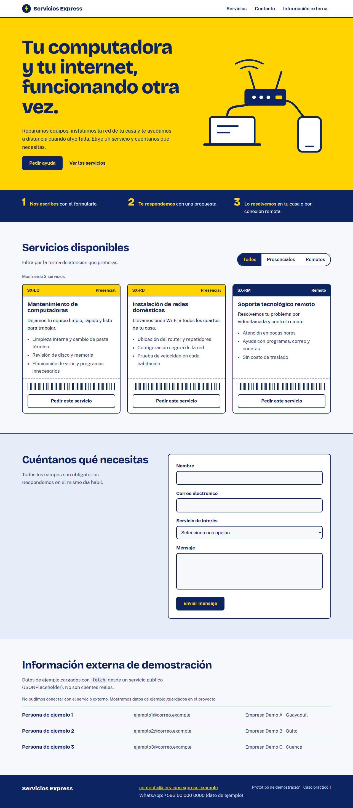

# Servicios Express – Miniaplicación web responsiva

**Autor/a:** Apellido Nombre *(reemplazar antes de entregar)*

## Objetivo
Construir una página de una sola página que permita a los clientes de Servicios Express conocer los tres servicios, filtrarlos, enviar un mensaje de contacto y verla bien en computadora y teléfono. Aplica HTML semántico, CSS responsivo, JavaScript y un componente de framework front-end.

## Planificación (Actividad 1)
- **Propósito:** presentar los servicios y conseguir que la persona pida ayuda.
- **Usuario principal:** persona o familia sin conocimientos técnicos que necesita arreglar su equipo o su internet.
- **Secciones:** (1) Presentación y servicios, (2) Formulario de contacto, (3) Información externa de demostración.
- **Información visible:** nombre, descripción, tres servicios con su modalidad, formulario, datos de contacto.
- **Acción principal:** pulsar «Pedir este servicio» y enviar el formulario.

```
+----------------------------------+
| Servicios Express   Servicios ...|  header + nav
+----------------------------------+
| Título + descripción | Cómo      |  presentación
| [Pedir ayuda]        | trabajamos|
+----------------------------------+
| [Todos][Presenciales][Remotos]   |  filtro
| [Tarjeta] [Tarjeta] [Tarjeta]    |  servicios
+----------------------------------+
| Texto            | Formulario    |  contacto
+----------------------------------+
| Información externa (3 tarjetas) |
+----------------------------------+
| Pie: contacto                    |
+----------------------------------+
```
En móvil todo se apila en una sola columna.

## Herramientas utilizadas
HTML5, CSS3 (Grid, Flexbox, `clamp()`, media queries), tipografías Bricolage Grotesque y Public Sans (licencia OFL, incluidas en `fuentes/`), ilustración SVG propia, JavaScript, **Vue 3** (versión 3.4.21, incluida en `js/vendor/` para que funcione sin internet) y `fetch` con JSONPlaceholder.

## Cómo abrirlo
1. Descomprime el .zip.
2. Haz doble clic en `index.html` (no requiere instalación ni servidor).

## Capturas
| Escritorio | Móvil |
|---|---|
|  |  |

## Las dos interacciones
- **A. Filtro de servicios** (`js/app.js`): tres botones (Todos, Presenciales, Remotos). Mantenimiento y redes se clasificaron como presenciales; soporte, como remoto. El filtro es un estado de Vue y la lista se recalcula sola; un mensaje anuncia cuántos servicios se muestran.
- **B. Validación del formulario** (`js/formulario.js`): al enviar se comprueba que nombre, correo, servicio y mensaje tengan contenido y que el correo cumpla un formato básico (`nombre@dominio.com`). Cada error aparece bajo su campo; si todo es correcto se muestra una confirmación. No se envía a ningún servidor.

## Componente creado
`TarjetaServicio` (en `js/app.js`), con aspecto de etiqueta de servicio: recibe `nombre`, `descripcion` y `modalidad` (más `codigo`, una lista `incluye` y el estado `seleccionado`) y se reutiliza para los tres servicios. Al pulsar su botón, preselecciona ese servicio en el formulario.

## Fuente de datos externa
`https://jsonplaceholder.typicode.com/users?_limit=3` (API pública de pruebas, formato JSON). Se muestran 3 registros en «Información externa de demostración».
**Limitación y solución:** si el servicio no responde (o tarda más de 6 s), se muestran 3 registros de respaldo y un aviso. Los datos de respaldo están dentro de `js/externo.js` y no en un `.json` aparte, porque el navegador bloquea `fetch` de archivos locales al abrir la página con doble clic.

## Pruebas realizadas
Carga sin errores en consola; filtro correcto (3/1/2/3 tarjetas); validación de campos vacíos y de correo mal escrito; confirmación al enviar; sin desplazamiento horizontal a 1280, 390 y 320 px; botones de al menos 44 px de alto; el error de la API se gestiona con datos de respaldo. *Nota:* las capturas se tomaron sin conexión a internet, por eso muestran el aviso de respaldo; con internet mostrarán los usuarios de la API.

## Reflexión final
**Estructura:** el HTML semántico (header, nav, main, section, article, footer, formulario). **Presentación:** el CSS (colores, rejilla, adaptación a móvil). **Comportamiento:** JavaScript, es decir, la validación y la carga con `fetch`. **Gestión de estado:** Vue guarda el filtro activo y el servicio elegido, y la pantalla se actualiza sola cuando cambian.
